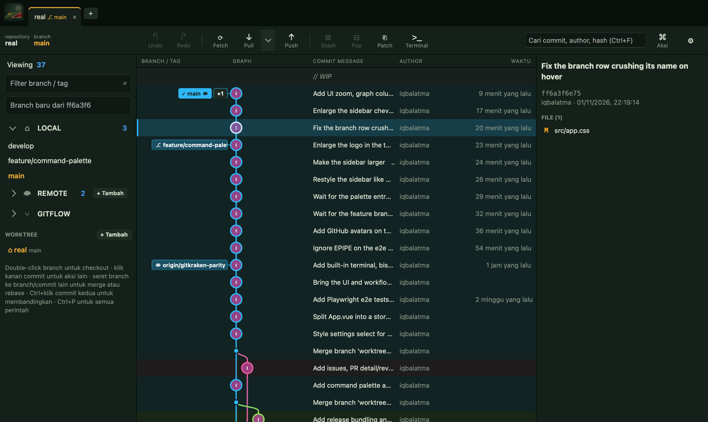

# gitpuake

Git client desktop ala GitKraken. Ringan (Tauri 2 + Vue 3, tanpa Chromium bawaan), dan semua operasinya
dijalankan oleh `git` yang sudah ada di komputermu, jadi hasilnya sama persis dengan yang kamu lihat di terminal.



## Fitur

**Graph dan commit**
- Commit graph berlane dengan warna per branch, foto committer (dari GitHub), body commit inline, virtual scroll sampai 20.000 commit
- Stage dan unstage per file, per hunk, atau per baris; commit, amend, discard, dan **undo / redo** (Ctrl+Z / Ctrl+Shift+Z)
- Diff split atau unified dengan syntax highlight, beda per kata, abaikan spasi, diff gambar berdampingan
- Riwayat file, blame, bandingkan dua commit (Ctrl+klik), cari commit (Ctrl+F)
- Daftar file bisa ditampilkan sebagai pohon folder

**Branch dan history**
- Buat, checkout, rename, hapus (lokal dan remote), merge (`--no-ff`, squash), rebase, seret branch untuk merge atau rebase
- **Interactive rebase** (pick, reword, squash, fixup, drop), edit pesan commit lama, dan Shift+klik untuk memilih banyak commit lalu cherry-pick, squash, atau drop
- Menu klik kanan commit dan branch: checkout, branch, tag, cherry-pick, revert, reset, push dan set upstream, patch
- **Reflog**, **bisect** (good, bad, skip), dan **Gitflow** (feature, release, hotfix)
- Editor merge conflict, banner untuk operasi yang sedang berjalan, filter graph (sembunyikan atau solo branch)

**Remote dan kolaborasi**
- Fetch, pull (merge, rebase, fast-forward), push (force push dengan `--force-with-lease` saat ditolak), auto-fetch
- Pull Request GitHub (daftar, checkout, buat, detail dengan checks, komentar, review, merge, diff file) dan daftar **PR yang menunggu review kamu**
- Issue GitHub dan GitLab (lihat, buat, buat branch dari issue), Merge Request GitLab, link PR Bitbucket
- Kelola remote, tag, submodule, worktree, dan Git LFS

**Lainnya**
- Tab multi-repo, **terminal bawaan** (Ctrl+`), command palette (Ctrl+P) dengan semua perintah
- Stash (per file, lihat isi sebelum apply), simpan dan terapkan patch (`format-patch`, `am`, `apply`)
- Pengaturan: identitas git lokal atau global, profil identitas, tanda tangan commit, tema gelap, terang, atau ikut sistem, zoom UI, dan kolom graph

## Privasi

- Semua perintah berjalan lokal. gitpuake tidak punya server dan tidak mengirim apa pun ke pihak ketiga.
- Foto committer diambil lewat `gh api` dari GitHub, jadi tidak ada email yang dikirim ke luar.
- Avatar Gravatar **mati secara bawaan**, karena mengirim hash email author ke gravatar.com. Aktifkan di Pengaturan kalau mau.

## Jalankan

Butuh [Rust](https://rustup.rs), Node, dan git.

- **macOS:** Xcode Command Line Tools (`xcode-select --install`). Rust bisa lewat `brew install rustup && rustup default stable`.
- **Linux:** dependency sistem Tauri, misalnya `libwebkit2gtk-4.1-dev libappindicator3-dev librsvg2-dev patchelf`.

Opsional: [GitHub CLI](https://cli.github.com) (`gh auth login`) untuk Pull Request, issue, foto committer, dan notifikasi review;
[GitLab CLI](https://gitlab.com/gitlab-org/cli) (`glab auth login`) untuk Merge Request GitLab.

```sh
npm install
npm run tauri dev      # development
npm run tauri build    # bundle rilis
```

## Shortcut

Di macOS, `Ctrl` berarti `Cmd`.

| Shortcut | Aksi |
| --- | --- |
| `Ctrl+P` | Command palette (semua perintah, termasuk checkout branch) |
| `Ctrl+Z` / `Ctrl+Shift+Z` | Undo / redo |
| `Ctrl+F` | Cari commit |
| `F5` | Fetch semua remote |
| `Ctrl+Shift+K` | Push |
| `Ctrl+Shift+S` | Stash perubahan |
| `` Ctrl+` `` | Terminal |
| `Ctrl+=` / `Ctrl+-` / `Ctrl+0` | Zoom UI |
| `Ctrl+,` | Pengaturan |
| `Ctrl+O` / `Ctrl+W` / `Ctrl+Tab` | Buka repo / tutup tab / ganti tab |
| `Ctrl+klik` commit | Bandingkan dua commit |
| `Shift+klik` commit | Pilih banyak commit |

## Cara kerja

```
src/            frontend Vue 3: store.js (state dan aksi), komponen, dan modul murni (graph, diff, rebase, ...)
src-tauri/      backend Rust: menjalankan git / gh / glab / shell dan membaca file repo dengan aman
e2e/            tes Playwright dengan git sungguhan di repo sementara
```

Frontend memanggil backend lewat beberapa perintah Tauri saja (`git`, `shell`, `gh`, `glab`, `read_file`, `write_file`, ...).
Logika yang bisa diuji tanpa UI (parser log, layout graph, diff, rebase, merge) ada di modul `.js` murni dengan tes `*.test.js` di sebelahnya.

## Tes

```sh
for t in src/*.test.js; do node "$t"; done          # tes logika murni
npx playwright install webkit && npm run test:e2e   # alur utama di WebKit, dengan git sungguhan
(cd src-tauri && cargo test --lib)                  # backend Rust
```

CI (`.github/workflows/ci.yml`) menjalankan build, ketiga tes di atas, di setiap push dan pull request ke `main`.

## Rilis dan update

Rilis dibangun otomatis oleh GitHub Actions (`.github/workflows/release.yml`) di Linux, macOS, dan Windows.

1. Samakan versi di `package.json`, `src-tauri/tauri.conf.json`, dan `src-tauri/Cargo.toml`, commit.
2. `git tag v0.2.0 && git push --tags`
3. Setelah workflow selesai, buka tab **Releases** di GitHub: ada rilis **draft** berisi `.deb`, `.AppImage`, `.rpm`
   (Linux), `.dmg` (macOS), `.msi` + `-setup.exe` (Windows). Cek, lalu klik **Publish**.

Workflow juga bisa dijalankan manual (Actions → release → Run workflow). Build lokal: `npm run tauri build -- --bundles deb`
→ `src-tauri/target/release/bundle/deb/`. Paket `.deb` otomatis bergantung pada `git`.

Installer macOS belum ditandatangani dan di-notarize, jadi macOS akan memberi peringatan saat pertama dibuka.

**Auto-update belum aktif** karena butuh kunci tanda tangan yang hanya boleh dipegang pemilik repo. Untuk mengaktifkan:

1. `npx tauri signer generate -w ~/.tauri/gitpuake.key` — simpan private key dan password-nya baik-baik (jangan di-commit).
2. Di GitHub → Settings → Secrets → Actions, tambahkan `TAURI_SIGNING_PRIVATE_KEY` (isi file key) dan
   `TAURI_SIGNING_PRIVATE_KEY_PASSWORD`, lalu teruskan keduanya sebagai `env` di langkah `tauri-action` pada `release.yml`.
3. `npm run tauri add updater` (menambah crate `tauri-plugin-updater`, paket `@tauri-apps/plugin-updater`, dan permission).
4. Di `tauri.conf.json`: `"bundle": { "createUpdaterArtifacts": true }` dan
   `"plugins": { "updater": { "pubkey": "<isi file .key.pub>", "endpoints": ["https://github.com/Atma-Dev/gitpuake/releases/latest/download/latest.json"] } }`.
5. Di `release.yml` tambahkan `includeUpdaterJson: true` pada `tauri-action`, lalu panggil `check()` dari
   `@tauri-apps/plugin-updater` di frontend (mis. saat start) dan `downloadAndInstall()` bila ada versi baru.

## Batasan

- Terminal bawaan belum memakai pty, jadi program interaktif (`vim`, prompt `ssh`) tidak berjalan.
- Interactive rebase yang melewati merge commit belum didukung.
- Foto committer dan notifikasi review hanya untuk repo GitHub; GitLab belum.
